# Report - Data Structures: DynamicArray, MyLinkedList, MinHeap

Author: Bekarys Zharylgassyn

Measurement machine for the checked-in results: AMD Ryzen @ 3.6 GHz, 12 vCPU, 16 GB RAM, OpenJDK 21, seed 42. Absolute times depend on the machine; counters do not.

## 1. Design summary

- All three structures store primitive `int` values. There are no boxed `Integer` values and no `java.util` collection inside any structure.
- `DynamicArray` starts with capacity 8 and doubles when full. `MyLinkedList` is doubly linked with `head` and `tail`; `get(i)` walks from the nearer end. `MinHeap` is a binary min-heap in an `int[]` with the same doubling rule.
- `DynamicArray` and `MyLinkedList` implement one `IntList` interface, so the same benchmark code runs both.
- Counters live inside the operations (see README for definitions): comparisons, moves (element or link writes) and steps (elements or nodes visited, created or copied). `MyLinkedList` therefore reports non-zero moves and steps in every mutation, including W3.
- Sift operations use the hole technique: the moving value is kept in a local variable and written once at the end, so one level costs one move instead of a swap.

## 2. Complexity table

n is the current size. "avg" assumes a uniformly random index (lists) or random keys (heap).

### DynamicArray

| Operation | Best Ω | Average Θ | Worst O | Justification |
|---|---|---|---|---|
| `get(i)`, `set(i, x)` | Ω(1) | Θ(1) | O(1) | direct index access |
| `addLast(x)` | Ω(1) | Θ(1) amortized | O(n) | a resize copies n elements, but it happens rarely (section 3.1) |
| `addFirst(x)` | Ω(n) | Θ(n) | O(n) | always shifts all n elements |
| `insert(i, x)` | Ω(1) | Θ(n) | O(n) | best at `i = n`, average shifts n/2 elements, worst at `i = 0` |
| `removeAt(i)` | Ω(1) | Θ(n) | O(n) | best at the last index |
| `removeLast()` | Ω(1) | Θ(1) | O(1) | no shift |
| `removeFirst()` | Ω(n) | Θ(n) | O(n) | shifts n-1 elements |
| `indexOf(x)` | Ω(1) | Θ(n) | O(n) | best when the first element matches |

### MyLinkedList

| Operation | Best Ω | Average Θ | Worst O | Justification |
|---|---|---|---|---|
| `addFirst`, `addLast`, `removeFirst`, `removeLast` | Ω(1) | Θ(1) | O(1) | head and tail pointers, no traversal |
| `get(i)`, `set(i, x)` | Ω(1) | Θ(n) | O(n) | best at either end; average about n/4 hops, worst about n/2 hops in the middle |
| `insert(i, x)`, `removeAt(i)` | Ω(1) | Θ(n) | O(n) | one traversal to position i, then constant relinking |
| `indexOf(x)` | Ω(1) | Θ(n) | O(n) | linear scan |

### MinHeap

| Operation | Best Ω | Average Θ | Worst O | Justification |
|---|---|---|---|---|
| `peek()` | Ω(1) | Θ(1) | O(1) | root |
| `insert(x)` | Ω(1) | Θ(1) | O(log n) | stops at once if x is not smaller than its parent; for random keys the measured cost is about 2.3 comparisons; worst case climbs the height |
| `extractMin()` | Ω(1) | Θ(log n) | O(log n) | best only with equal keys; the moved last element normally sinks to the bottom |
| `buildHeap(a)` (Floyd) | Ω(n) | Θ(n) | O(n) | proof in section 3.3 |
| n separate `insert` | Ω(n) | Θ(n) | O(n log n) | sorted ascending input costs n; descending input costs n log n; random input is linear on average |

## 3. Proofs

### 3.1 Amortized cost of `addLast` with 2x growth

Start with capacity 8. Resizes happen when the size reaches 8, 16, 32, ..., 2^m, where 2^m < n is the last one. They copy 8 + 16 + ... + 2^m = 2^(m+1) - 8 < 2n elements. Together with n writes of the new values the total is below 3n, so the amortized cost per append is at most 3 = Θ(1). Measured at n = 1 000 000: 2 048 568 moves, which is 1 write plus 1.05 copy per element, and 1 048 568 copy steps, below 2n.

### 3.2 Loop invariants

#### Proof A - the shift loop of `DynamicArray.insert`

```
for (int i = size; i > index; i--) data[i] = data[i - 1];
```

Let s be the size before the call, a[0..s-1] the original contents, 0 <= index <= s, and capacity at least s + 1.

1. **Invariant.** At every evaluation of the loop condition, with the current value of i:
   - (a) `data[j] = a[j-1]` for every j with i < j <= s;
   - (b) `data[j] = a[j]` for every j with 0 <= j <= min(i, s-1).
2. **Initialization.** Before the first test, i = s. Part (a) ranges over s < j <= s, which is empty. Part (b) says data[0..s-1] equals a[0..s-1], which is true because nothing has been modified.
3. **Maintenance.** Assume the invariant holds and i > index, so the body runs: `data[i] = data[i-1]`. Since i <= s, index i-1 <= s-1, so by (b) data[i-1] = a[i-1]. After the assignment data[i] = a[i-1], which extends (a) to the range j >= i, the range required for the new value i-1. For (b) and the new value i-1, only slot i was written and i is outside 0..i-1, so every slot in 0..min(i-1, s-1) is unchanged and still equal to a[j]. The invariant holds after `i--`.
4. **Termination.** i starts at s and drops by one per iteration, so the loop stops when i = index after exactly s - index iterations. The cost is therefore s - index moves, Θ(n) in the worst case (index = 0) and 0 shifts in the best case (index = s).
5. **Correctness.** At exit i = index. By (a), data[index+1..s] = a[index..s-1]. By (b), data[0..index-1] = a[0..index-1]. Slot index holds a stale copy, and the statement `data[index] = value` overwrites it. The array now holds a[0..index-1], value, a[index..s-1]: the original sequence with value inserted at position index, with nothing lost, duplicated or reordered. The size becomes s + 1.

#### Proof B - the loop of `MinHeap.siftDown`

```
while (index < half) { pick smaller child c; if (value <= data[c]) break; data[index] = data[c]; index = c; }
data[index] = value;
```

Let the call start at index s with moving value v and heap size n, and let T be the subtree rooted at s. The hole is the slot `index`; its logical content is v. Precondition P: every parent-child pair (p, q) inside T with p != s satisfies data[p] <= data[q] (both subtrees of s are heaps). `extractMin` calls with s = 0 and v = the old last element; `buildHeap` calls with s = i after all indices greater than i are heap roots.

1. **Invariant.** At every evaluation of the loop condition, with hole h = `index`:
   - (I1) every parent-child pair (p, q) in T with p != h and q != h satisfies data[p] <= data[q];
   - (I2) if h != s, then data[parent(h)] <= data[c] for every child c of h inside the heap;
   - (I3) the multiset of values in the slots of T other than h, together with v, equals the multiset at entry;
   - (I4) if h != s, then data[parent(h)] < v.
2. **Initialization.** At entry h = s. (I1) is exactly P, because the pairs excluded by p != s and q != s are those that mention s. (I2) and (I4) are vacuous since h = s. (I3) holds trivially.
3. **Maintenance.** Suppose the loop condition holds, so h has a left child, and the invariant holds. Let c be the child with the smaller key. If v <= data[c] the loop breaks (see Termination). Otherwise v > data[c] and the body writes data[h] = data[c] and moves the hole to c.
   - (I1) for the new hole c: pairs that did not involve h or c are unchanged. The pair (h, sibling of c) holds because data[h] now equals the old data[c], the smaller child. The pair (parent(h), h), if h != s, holds by (I2) applied to the old data[c]. Pairs with parent c or child c are excluded by the new hole.
   - (I2): the new parent of the hole is h with value old data[c], and by (I1) it was <= every child of c.
   - (I3): a value was copied from slot c to slot h and slot c became the hole, so the multiset is unchanged.
   - (I4): data[parent(c)] = data[h] = old data[c] < v, which is the condition of the branch taken.
4. **Termination.** The hole index strictly increases (a child index is larger than the parent index) and the loop requires index < n/2, so it stops after at most floor(log2 n) iterations, either by `break` or because the hole reached a leaf.
5. **Correctness.** After the loop, `data[h] = v` fills the hole. Pairs not involving h are ordered by (I1). If the exit was a `break`, v <= data[c] with c the smaller child, so v is also <= the other child; if h is a leaf there are no children. If h != s, then data[parent(h)] < v by (I4). Hence every pair in T is ordered, and by (I3) T holds the same multiset as before. For `extractMin` this restores the heap after removing the root; for `buildHeap` it makes slot i a valid heap root, which carries the induction "all indices greater than i are heap roots" down to i = 0.

### 3.3 Floyd's `buildHeap` runs in O(n)

Nodes at height k (height 0 = leaves) number at most ceil(n / 2^(k+1)), and `siftDown` from such a node does at most k levels, at most 2 comparisons each. The total is at most

2 * sum over k of k * ceil(n / 2^(k+1)) <= 2n * sum over k of k / 2^k * (1/2 * 2) = O(n),

because the series sum of k / 2^k converges to 2. So `buildHeap` needs at most about 2n comparisons. Separate inserts cost O(log n) each in the worst case, so O(n log n) in total in the worst case (descending input); for random input each insert is O(1) on average.

## 4. Benchmark method

Each scenario runs 3 untimed warm-up runs and then 5 timed runs, with `System.gc()` before each timed run. The median is reported. Inputs come from `java.util.Random(seed ...)`, so one seed and one command regenerate `results/results.csv` with identical counters. W2 builds the list before the timer and resets the counters; only the 1000 queries are measured. Workload list and CSV columns are in the README.

## 5. Results

### W1 - append n elements

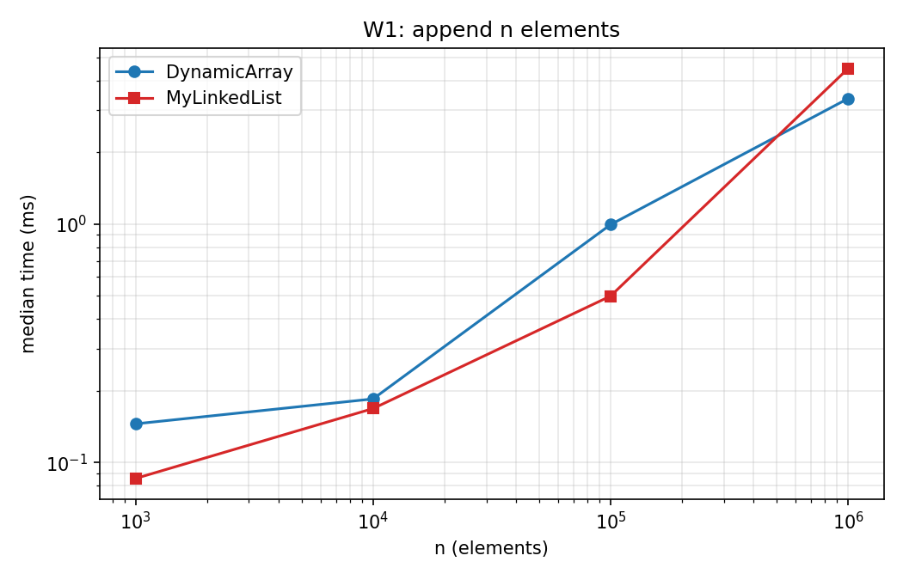

Both structures are Θ(n) in total. The two are close, and the array is ahead at n = 10^6 (3.4 ms against 4.5 ms) because the linked list allocates 10^6 node objects while the array allocates about 21 arrays in total. Counted moves: 2.05 per element for the array (one write plus amortized 1.05 copies), 5 per element for the list (three to initialise the node, two for linking).

### W2 - random access

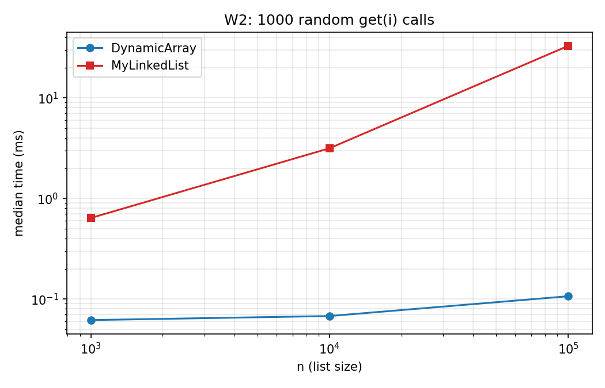
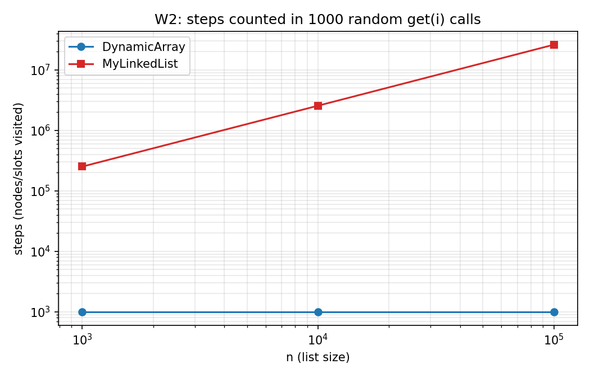

1000 `get(i)` calls cost exactly 1000 steps in the array whatever n is. In the list they cost 251 850 steps at n = 1 000 and 26 073 018 steps at n = 10^5, which is 252 and 26 073 hops per call and matches the predicted n/4 average (the nearer end is always at most n/2 away). At n = 10^5 the time is 0.11 ms against 32.8 ms, a factor of about 300, while the step ratio is about 26 000. The time ratio is smaller than the step ratio because this list was built by sequential appends: its nodes lie in memory in list order, so hops are cheap (about 1.3 ns each) and prefetch-friendly, while a single array `get` measures about 100 ns here, most likely cache misses on random positions plus fixed timing overhead. Section 6 shows the same list costs about 2.7 times more per hop when its nodes are linked in random order.

### W3 - inserts

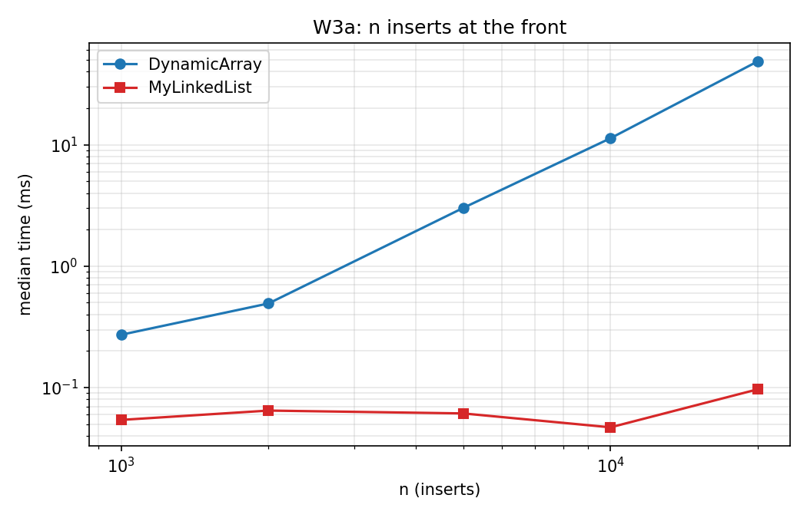
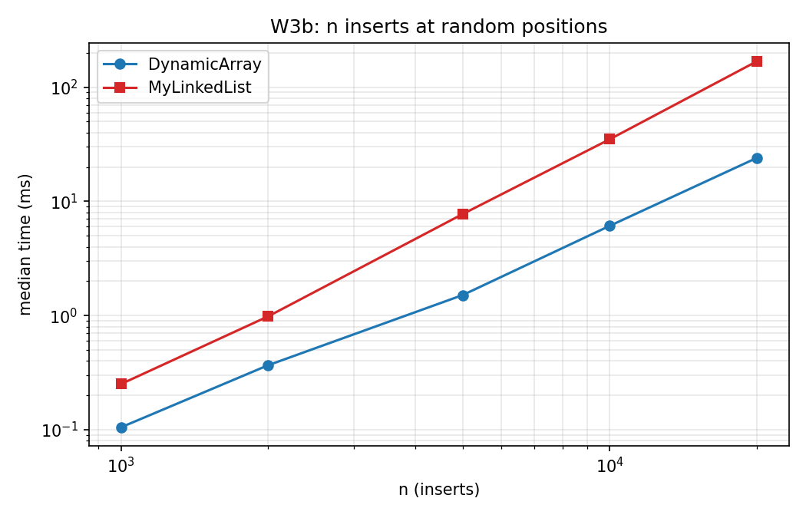
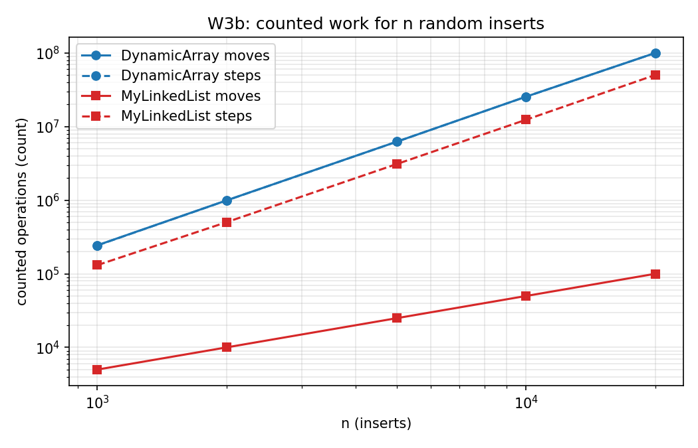

- W3a (insert at the front): the array is Θ(n^2) in total (200 million moves at n = 20 000, 48.6 ms) and the list is Θ(n) (100 000 moves, 0.10 ms). Here the list wins by orders of magnitude.
- W3b (insert at random positions): both structures are Θ(n^2) in total. The array shifts about n/4 elements per insert on average (100 million moves at n = 20 000); the list walks about n/8 nodes on average (50 million steps), so it executes about half as many counted operations. Yet the array takes 24 ms and the list 169 ms. This is the central observation of the assignment and is explained in section 6.

### W4 - MinHeap

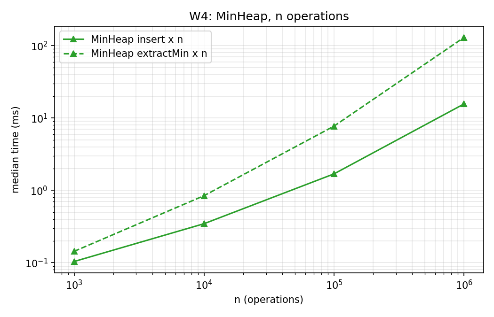
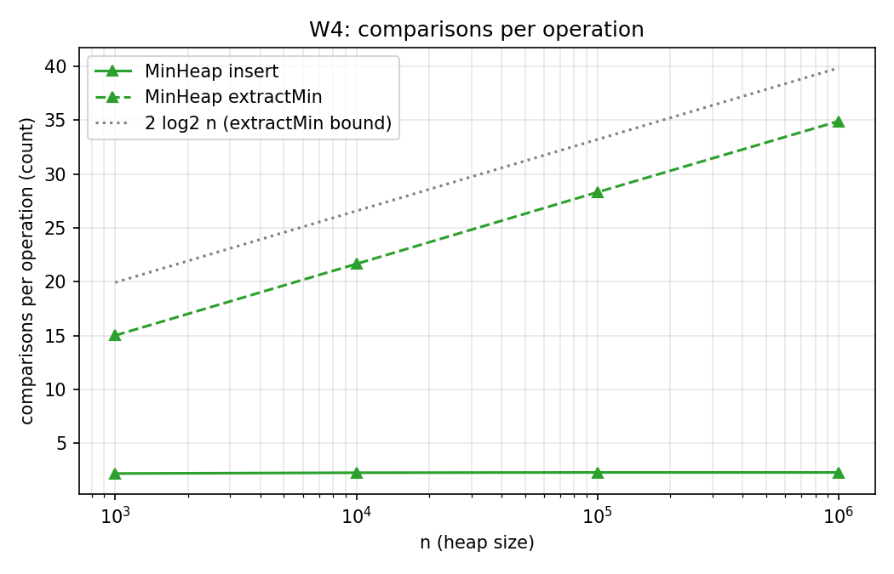

`insert` costs about 2.2 to 2.3 comparisons on average for random keys at every n, which supports O(1) average. `extractMin` costs 28.3 comparisons per call at n = 10^5 and 34.9 at n = 10^6, below the bound 2 log2 n of 33.2 and 39.9 and growing logarithmically.

### W5 - Floyd's buildHeap against n inserts (bonus B)

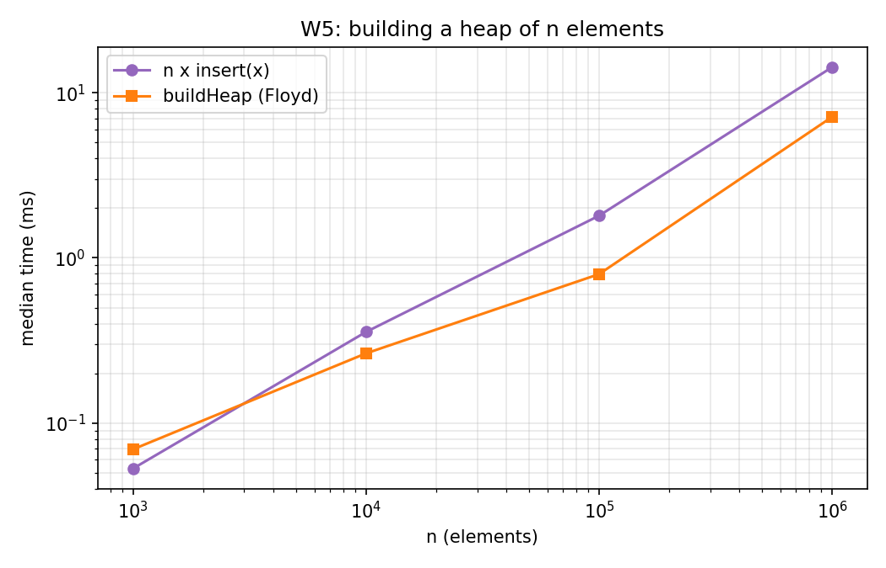
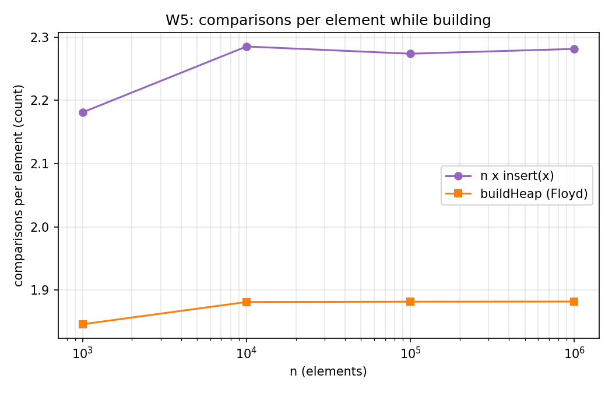

| n | n x insert: comparisons | buildHeap: comparisons | n x insert: ms | buildHeap: ms |
|---|---|---|---|---|
| 1 000 | 2 181 | 1 846 | 0.053 | 0.069 |
| 10 000 | 22 851 | 18 811 | 0.356 | 0.264 |
| 100 000 | 227 369 | 188 157 | 1.802 | 0.797 |
| 1 000 000 | 2 281 269 | 1 881 815 | 14.309 | 7.150 |

Floyd's method uses about 1.88 comparisons per element (bound: 2) against 2.28 for repeated insertion on random input, and is faster for n >= 10^4: about 1.35 times at n = 10^4 and about 2 times at n >= 10^5. The gap is only a constant factor on random data, because random inserts are linear on average; the asymptotic separation O(n) against O(n log n) appears on adversarial input (descending order), where each insert climbs to the root. The n = 1000 row is the exception: Floyd is slower (0.069 against 0.053 ms), but both runs last well under 0.1 ms, which is within the noise of JIT compilation and timer resolution, so no conclusion should be drawn from it.

## 6. Why equal Big-O gives different real time (cache analysis)

W3b has the same Θ(n^2) total for the array and the list, yet the array is about 7 times faster at n = 20 000 while executing twice as many counted operations. The counters measure how much work is done, not how expensive each unit is.

- **Contiguous layout.** An `int[]` stores 16 values per 64-byte cache line. The shift loop reads and writes consecutive addresses, so every cache line fetched is used 16 times, the hardware prefetcher predicts the stream, and the JIT can unroll the loop. A shift step costs well under one nanosecond: 100 million moves in 24 ms is about 0.24 ns each.
- **Pointer chasing.** Each list hop loads the next address from the node just loaded, so the loads form a dependency chain. The CPU cannot start hop k+1 until hop k has arrived, and the prefetcher cannot predict the address. 50 million hops in 169 ms is about 3.4 ns each, about 14 times the array's cost per unit. Nodes created by random insertion also end up linked in an order unrelated to their addresses, so successive hops land on different cache lines.
- **Object size.** A node occupies 24 bytes, so only 2 to 3 nodes share a cache line and only 4 of the 24 bytes are payload; the working set is about 6 times larger than the array's (section 7), which pushes it out of L1 and L2 sooner.
- **Allocation.** The list allocates one object per element, which adds garbage collector work that the array does not have.

The same effect explains W2: n/4 dependent hops per `get` make list access about 300 times slower at n = 10^5, even though that list is laid out in address order and hops cost only about 1.3 ns each (32.8 ms for 26.07 million hops). The W3b list costs 3.4 ns per hop because random insertion links nodes in an order unrelated to their addresses. The array loses only where the work really differs asymptotically (W3a), because shifting n elements for every insert at the front is Θ(n) each time against Θ(1).

Boxed values would make this worse for both structures: an `Integer` object costs 16 bytes plus a 4-byte reference, so a boxed array would also chase pointers. This is why all structures here store `int`.

## 7. Memory footprint (bonus A)

Measured with JOL 0.17 (`GraphLayout.parseInstance(...).totalSize()`, minus the 40-byte `Metrics` counter object that every structure holds). JVM: 64-bit HotSpot, compressed oops enabled.

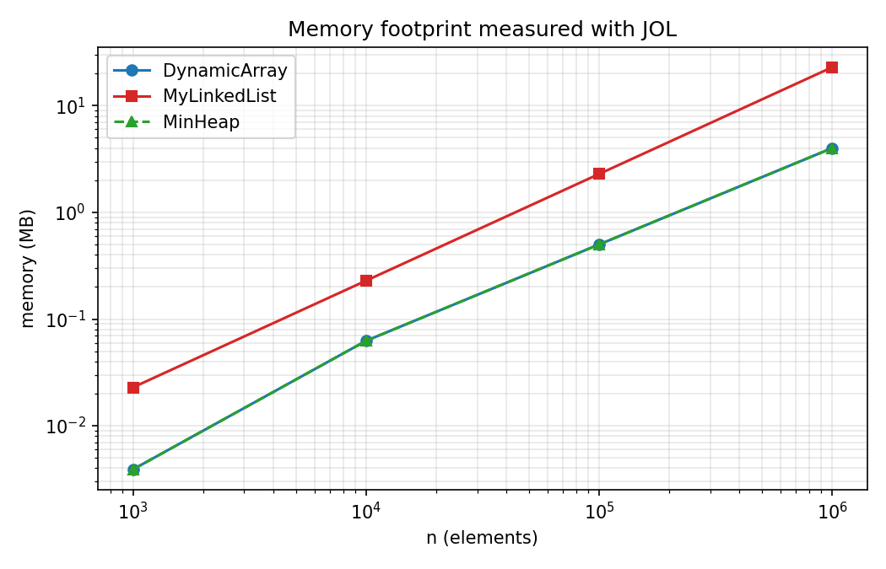

| n | DynamicArray (MB) | MyLinkedList (MB) | MinHeap (MB) | list / array |
|---|---|---|---|---|
| 1 000 | 0.0039 | 0.0229 | 0.0039 | 5.8 |
| 10 000 | 0.0625 | 0.2289 | 0.0625 | 3.7 |
| 100 000 | 0.5000 | 2.2888 | 0.5000 | 4.6 |
| 1 000 000 | 4.0000 | 22.8882 | 4.0000 | 5.7 |

**Array and heap.** Both are one `int[]` plus a small header object, so they are identical. The cost per element is 4 bytes plus the unused tail of the last doubling: 4.19 bytes per element at n = 10^6 (capacity 1 048 576) but 6.56 at n = 10^4 (capacity 16 384, 39% unused). Doubling therefore trades up to 2x memory for amortized O(1) appends.

**Node overhead.** JOL reports a `MyLinkedList$Node` of 24 bytes:

| Field | Bytes |
|---|---|
| object header: mark word | 8 |
| object header: compressed class pointer | 4 |
| `int value` | 4 |
| `Node prev` (compressed reference) | 4 |
| `Node next` (compressed reference) | 4 |
| alignment padding | 0 (24 is already a multiple of 8) |

Only 4 of 24 bytes (17%) are data; the header takes 50% and the two pointers 33%, so the list needs a constant 24 bytes per element against 4 (best case) for the array. With compressed oops disabled (heap above about 32 GB) the header grows to 16 bytes and the references to 8 bytes each, giving 4 + 16 + 16 = 36 rounded up by alignment to 40 bytes per node, of which 4 bytes plus 4 padding bytes are not useful data.

## 8. Reproducibility and limitations

- `mvn -q compile exec:java` regenerates `results/results.csv` from seed 42; counters repeat exactly, times vary by machine. For the defense, rerun the benchmark on your own machine.
- The checked-in times were measured on a desktop machine with other programs possibly running, so small absolute values (0.05 to 0.2 ms) are noisy; ratios between large runs are stable.
- Only W2 uses 1000 fixed queries; its list sizes stop at 10^5 because 10^6 would take minutes with Θ(n) per access.
